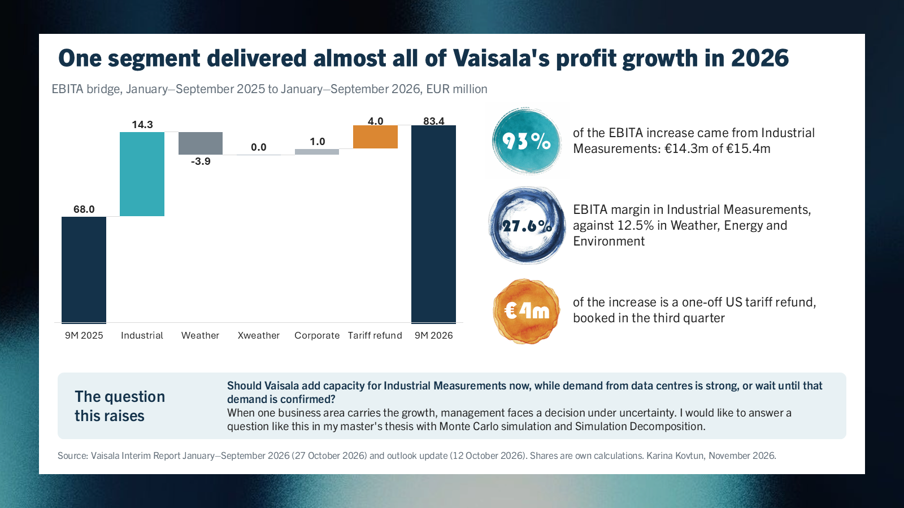

# Vaisala EBITA bridge, January–September 2026

A one-slide analysis of Vaisala's profit growth, built from the company's public interim report.

**Slide:** [Vaisala_slide.pdf](Vaisala_slide.pdf)

## Finding

Vaisala's EBITA rose from EUR 68.0 million to EUR 83.4 million between January–September 2025 and January–September 2026.

- Industrial Measurements added EUR 14.3 million, which is 93% of the EUR 15.4 million increase.
- Weather, Energy and Environment declined by EUR 3.9 million, and Xweather was flat.
- EUR 4 million of the increase is a one-off US tariff refund booked in the third quarter.

## The question this raises

Should Vaisala add capacity for Industrial Measurements now, while demand from data centres is strong, or wait until that demand is confirmed? When one business area carries the growth, management faces a decision under uncertainty. I would like to answer a question like this in my master's thesis with Monte Carlo simulation and Simulation Decomposition.
## Sources and method

- Vaisala Interim Report January–September 2026, published 27 October 2026.
- Vaisala outlook update, published 12 October 2026.
- All figures are reported figures in EUR million. The shares are my own calculations.
- Built in Excel and PowerPoint.

Karina Kovtun, November 2026
